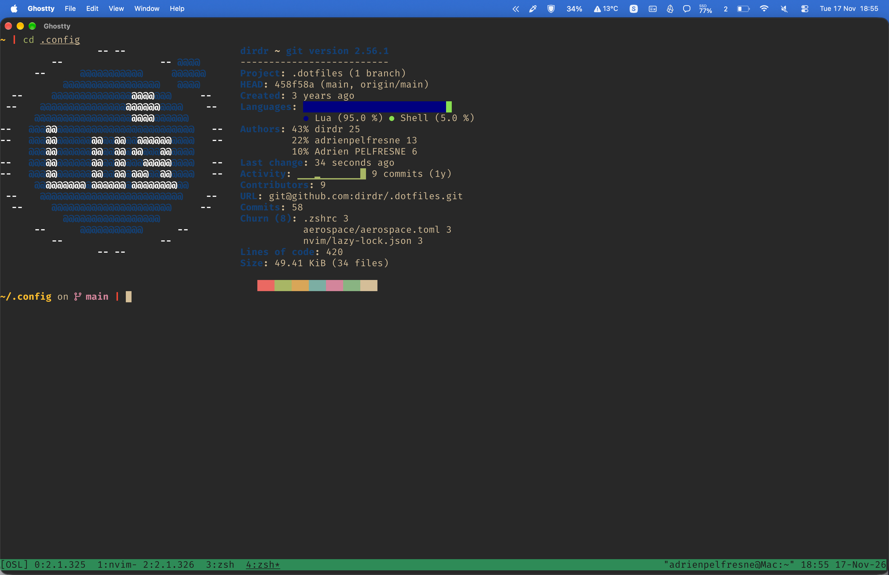
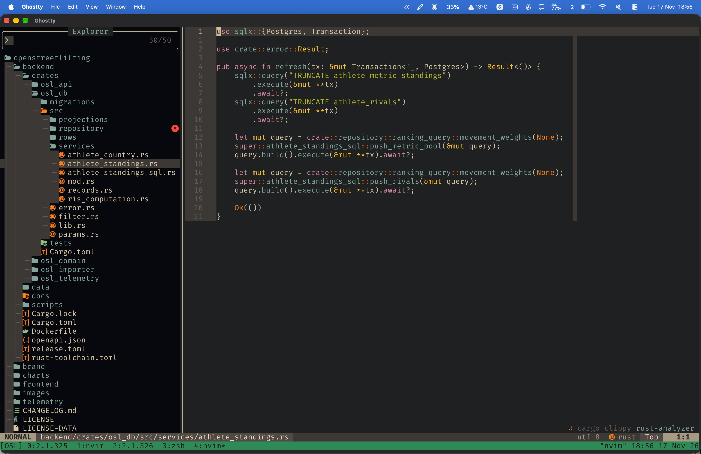

# MacOS dotfiles

My personal dotfiles for MacOs dev!





## What I use

- aerospace : window manager
- ghostty : terminal
- nvim : code editor
- tmux : terminal multiplexer (install tpm with `git clone https://github.com/tmux-plugins/tpm ~/.config/tmux/plugins/tpm`)
- starship.toml : shell prompt
- .zshrc : shell config, linked with `ln -sfn ~/.config/.zshrc ~/.zshrc`

Machine-specific shell config goes in `~/.zshrc.local` (untracked).

## Sync

Run `dotfiles-sync`

To track a new config directory, add `!/<name>/` to `.gitignore`.

## New machine

```sh
cd ~/.config
git init -b main
git remote add origin git@github.com:dirdr/.dotfiles.git
git fetch origin
git checkout -f -t origin/main
ln -sfn ~/.config/.zshrc ~/.zshrc
```
